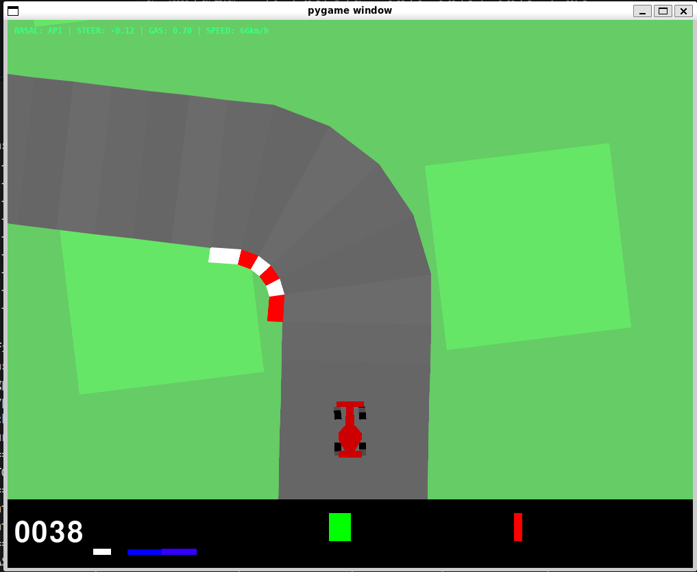
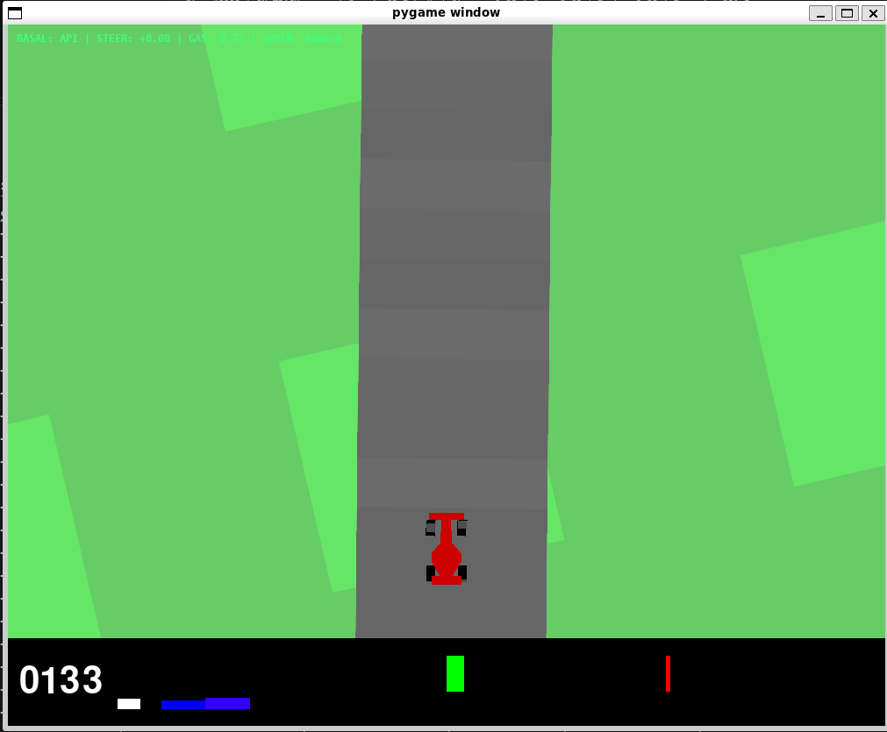
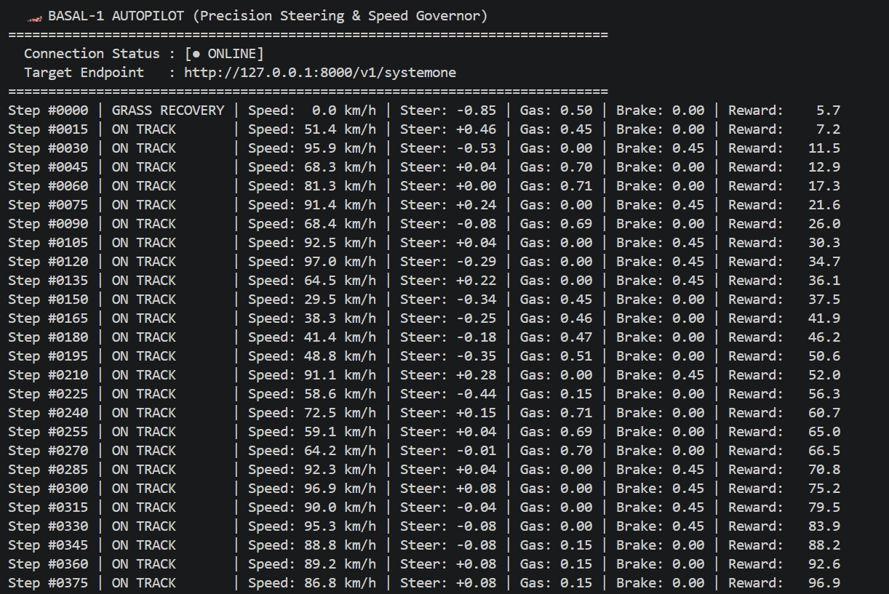
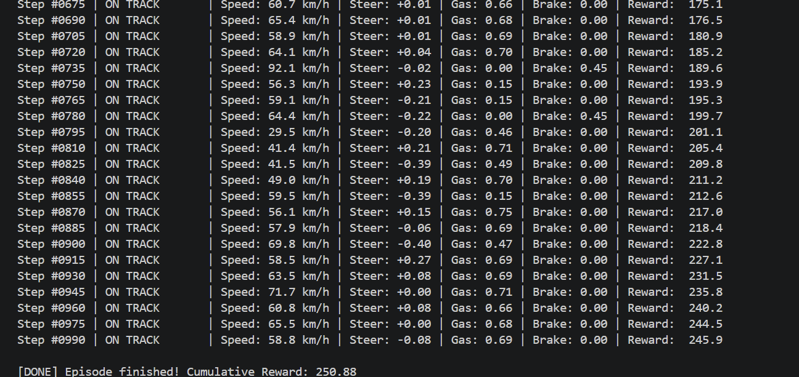

# 🏎️ **Basal‑1 Autonomous Driving Agent for OpenAI Gym CarRacing (v2/v3)**  
### *Precision Steering • Corrected Vision • Speed Governor • Active Track Centering*

This project implements an **autonomous driving agent** powered by **Basal‑1 System One**, a fast, calibrated decision engine designed for real‑time control tasks.  
The agent drives the **OpenAI Gymnasium CarRacing** environment (Box2D) using:

- **Corrected road perception** from a 96×96 RGB camera,  
- **Natural‑language telemetry reports**,  
- **Basal‑1 API decisions** for steering and throttle,  
- **Active track‑centering logic**,  
- **A dynamic speed governor**,  
- **Grass‑recovery mode** for off‑track correction.

The result is a stable, responsive autopilot capable of navigating complex track geometry without reinforcement learning.

---

## 📸 Screenshots

Below are the runtime outputs of the agent: the **Pygame game window** (top‑left HUD overlay) and the **terminal telemetry log** printed every 15 steps.

### 🎮 Pygame window — live game view with HUD overlay





### 🖥️ Terminal telemetry log — connection status & per‑step state





> **Legend**
> - **Pygame window (3.png / 4.png):** the live CarRacing scene. The top‑left HUD shows the Basal decision source, steering, throttle and speed. Text is **green** while the car is on asphalt and turns **red** during grass recovery.
> - **Terminal log (1.png / 2.png):** the startup banner (connection status + target endpoint) followed by one line per logged step: `Step | ON TRACK / GRASS RECOVERY | Speed | Steer | Gas | Brake | Reward`.

---

## 🐍 Python file — `car-racing.py`

The entire agent lives in a single self‑contained script: **`car-racing.py`**.
It has no external assets and no training step — it only needs the Basal‑1 REST endpoint
and the Gymnasium `CarRacing` environment. The file is organised into three clearly
separated blocks:

### 1. `class Basal` — Basal‑1 System One client
A thin REST client for the `POST /v1/systemone` endpoint.

- **`__init__(base_url)`** — stores the endpoint and runs a connection probe.
- **`_test_connection()`** — sends a lightweight “is the system operational?” probe and
  tries both `127.0.0.1` and `localhost` on port **8000**. Returns whether the API is
  reachable so the agent can fall back to `LOCAL‑SIM` when offline.
- **`evaluate_car_controls(context)`** — the core call. It packages the natural‑language
  telemetry (`context`) together with two **choice** questions (`steer` and `throttle`),
  POSTs it, and converts the returned probabilities into continuous control values:
  - `steer_weights` map `hard_left → -1.0` … `hard_right → +1.0`,
  - `throttle_weights` map `zero → 0.0` … `full → 1.0`.
  - Robust parsing handles `probabilities` / `probs` / `scores` dicts, plain `choice`
    strings, and nested `answers`/`questions`/`results` wrappers.
  - On any error it returns a safe default `{"steer": 0.0, "throttle": 0.5}` and marks
    itself `LOCAL‑SIM`.
- **`get_status_badge()`** — returns e.g. `[API ONLINE | 12.3ms]` or `[LOCAL-SIM (Offline)]`.

A single shared instance `b = Basal("http://127.0.0.1:8000")` is created at module level.

### 2. Vision module — `is_road()` and `extract_visual_telemetry()`
Pixel‑level road perception on the 96×96 RGB observation.

- **`is_road(pixel)`** — classifies a pixel as asphalt when R≈G≈B and brightness is
  between **85 and 130** (the gray road), cleanly separating it from the green grass
  and the red car body.
- **`extract_visual_telemetry(obs, env)`** — scans two horizontal lines of the frame:
  - **`y = 56`** (just in front of the car hood, safely above the red body at y≈66)
    to find the road centre and compute **`offset`** (lateral drift from centreline).
    If fewer than 7 road pixels are found the car is flagged **`on_grass`** and a
    full‑screen scan locates the asphalt to estimate the recovery offset.
  - **`y = 40`** (a ~20 m lookahead horizon) to compute **`curve`** (track bending
    left / right).
  - Reads the real speed from the Box2D hull (`linearVelocity × 3.6` → km/h).
  - Turns the numbers into a **natural‑language telemetry sentence** (the `context`
    string) such as:
    > “CarRacing Telemetry: Speed 72.4 km/h. Car is ON ASPHALT, drifting 3.2m to the
    > RIGHT of centerline. Upcoming track is gentle curve to the RIGHT. Steer to
    > maintain optimal racing line.”
  - Returns `context, speed, offset, curve, on_grass`.

### 3. Simulation loop — control fusion, speed governor & HUD
The `for step in range(1500)` main loop.

- **Frame skipping** (`FRAME_SKIP = 3`): the Basal API is queried only every third
  step; the last action is repeated in between to keep the physics smooth.
- **Grass recovery:** when `on_grass` is true the agent ignores the API and steers
  hard back toward the road (`±0.85`) with moderate throttle and no braking.
- **On‑track steering fusion:** `geo_steer = -offset·0.065 + curve·0.075` is blended
  with the Basal decision (`raw_steer·0.6 + geo_steer·0.7`) and clipped to ±1.0.
- **Corner speed governor:** a target speed of **82 km/h** on straights and **52 km/h**
  in technical corners. It launches from standstill, brakes when ~8 km/h over the limit,
  holds governed speed, and accelerates otherwise.
- **Pygame HUD overlay:** draws the status line
  `BASAL: <source> | STEER | GAS | SPEED` in green (on track) or red (grass).
- **Console logging:** every 15 steps it prints the step number, track status,
  speed, steering, throttle, brake and cumulative reward, and prints the final
  cumulative reward when the episode terminates.

The environment is created as `CarRacing-v3` (falling back to `CarRacing-v2`) with
`render_mode="human"`, and closed cleanly at the end.

---

## 🚀 Features

### ✔️ **Basal‑1 System One API Integration**
The agent communicates with a local Basal‑1 server:

```
POST /v1/systemone
```

It sends a structured natural‑language description of the current driving situation and receives:

- steering decision (choice or probability distribution),
- throttle decision,
- latency and connection status.

If the API is offline, the agent automatically switches to a **LOCAL‑SIM fallback**.

---

### ✔️ **Corrected Vision System (96×96 RGB)**
The agent extracts road geometry using pixel‑level analysis:

- Road detection at **y=56** (just in front of the car),
- Forward‑looking curvature detection at **y=40**,
- Grass detection using color segmentation,
- Computation of:
  - **offset** (lateral displacement from road center),
  - **curve** (track bending left/right),
  - **on_grass** (off‑track state).

This corrected vision eliminates the common “infinite grass recovery” problem.

---

### ✔️ **Active Track Centering (PD Steering Fusion)**
Steering is computed by combining:

1. **Basal‑1 steering decision**,  
2. **Geometric steering correction** based on offset and curve,  
3. **Adaptive blending** depending on Basal’s confidence.

This produces smooth, stable steering even in tight corners.

---

### ✔️ **Speed Governor**
The agent dynamically regulates speed:

- Full acceleration on straights,
- Reduced throttle in curves,
- Automatic braking when exceeding safe corner speed,
- Special handling for low‑speed starts.

This prevents overshooting corners and improves cumulative reward.

---

### ✔️ **Grass Recovery Mode**
If the car leaves the asphalt:

- The agent applies **strong steering toward the road**,  
- Uses **moderate throttle**,  
- Avoids braking,  
- Re‑centers the vehicle on the track.

This ensures fast and reliable recovery.

---

### ✔️ **HUD Overlay (Pygame)**
A real‑time HUD displays:

- Basal decision source (API / LOCAL‑SIM),
- Steering angle,
- Throttle level,
- Current speed,
- Color‑coded track status (green = on track, red = grass).

---

## 📡 Basal‑1 API Interaction

### Example request:

```json
{
  "state": "CarRacing Telemetry: Speed 72.4 km/h. Car is ON ASPHALT, centered on racing line. Upcoming track is gentle curve to the RIGHT.",
  "questions": {
    "steer": {
      "type": "choice",
      "instructions": "Which steering direction should the car wheels take to follow the road?",
      "criteria": {
        "hard_left": "Sharp turn left",
        "gentle_left": "Gentle turn left",
        "straight": "Centered straight",
        "gentle_right": "Gentle turn right",
        "hard_right": "Sharp turn right"
      }
    },
    "throttle": {
      "type": "choice",
      "instructions": "How much throttle acceleration should be applied?",
      "criteria": {
        "zero": "Coast with no gas",
        "light": "Light throttle 35%",
        "moderate": "Moderate throttle 60%",
        "strong": "Strong acceleration 85%",
        "full": "Full throttle 100%"
      }
    }
  }
}
```

### Example response:

```json
{
  "steer": {
    "probabilities": {
      "gentle_right": 0.62,
      "straight": 0.21,
      "hard_right": 0.10,
      "gentle_left": 0.05,
      "hard_left": 0.02
    }
  },
  "throttle": {
    "probabilities": {
      "moderate": 0.55,
      "strong": 0.33,
      "light": 0.10,
      "zero": 0.02
    }
  }
}
```

The agent converts these probabilities into continuous control values.

---

## 🧪 Requirements

- Python 3.10+
- gymnasium
- numpy
- requests
- pygame (optional HUD)
- Local Basal‑1 server running on port 8000

---

## ▶️ Running the Agent

### Start Basal‑1 server:
```bash
basal serve --port 8000
```

### Run the autopilot:
```bash
python car-racing.py
```

---

## 🏁 Summary

This project demonstrates how **Basal‑1 System One** can act as a fast, intuitive decision engine for autonomous driving:

- No reinforcement learning  
- No CNN  
- No transformer  
- Just **vision → natural‑language state → Basal‑1 decisions → continuous control**

A clean example of **System‑1 AI** applied to real‑time control.
